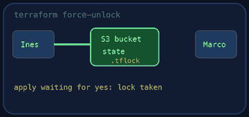
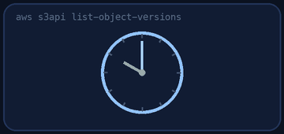
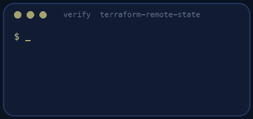
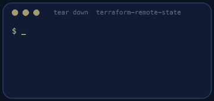

<p align="center"></p>

| | |
|-|-|
| **Time** | 75-90 min |
| **Cost** | free (S3 pennies) |
| **You need** | An AWS administrator user (the IAM lab), the AWS CLI v2, Terraform 1.10 or newer, git and a terminal |

## How this lab works

1. **Fork** this repository to your own GitHub account (button at the top right).
2. Clone **your fork** in your Ubuntu environment (WSL on Windows, your OrbStack machine on Mac).
3. Read the lab below (the same text is in [`LAB.md`](LAB.md)) and follow the mission.
4. Answer the questions in [`SUBMISSION.md`](SUBMISSION.md). Where a question asks for output, paste it in a code block. No screenshots needed.
5. Commit and push. Open the **Actions** tab of your fork (click *I understand my workflows, go ahead and enable them* the first time). The **Lab check** shows what is still missing.
6. When the check is green, **submit the URL of your fork** in the course platform.

> [!NOTE]
> The check only looks at your answers and any files the lab asks you to commit. Your instructor reads your work and may ask you to explain any line.

<p align="center"></p>

## 🎬 The situation

<p align="center"></p>

Today is your pairing session with Inês, the senior engineer who will be your mentor. She shares her screen and says, a little embarrassed:

> *"Last Thursday, Marco and I both ran `terraform apply` from our laptops, on the same afternoon. Each of us had a `terraform.tfstate` file on our own disk. Mine said the cache time was 300 seconds. His said it had been changed. We overwrote each other's work and neither of us noticed until the staging settings were wrong. Let's make sure it can never happen again. I'll ask questions, you drive."*

Terraform keeps a file, the **state**, that records what it believes exists. It is the most important file in the project and, by default, it lives on one person's disk. In this session you will move it somewhere safe and shared, watch the lock stop a second engineer, survive a bad apply, and prove that the setup works.

The thing under management is deliberately tiny: three Clippy settings in the AWS parameter store (free). The lesson is not the resource, it is the state.

> [!IMPORTANT]
> **Your mission**
> - Create a **state bucket** that is versioned, encrypted and private
> - Move the state into it with an **S3 backend** that uses **native locking**
> - Watch the lock stop a second `apply`, and read the lock file in S3
> - Survive a **bad apply**: find the previous state version, restore it, and let Terraform repair the real world
> - Prove it, then tear it down

**Time:** 75-90 min | **Cost:** free (S3 pennies) | **You need:** an AWS administrator user (the IAM lab), the AWS CLI v2, Terraform 1.10 or newer, git and a terminal

<p align="center"></p>

## Part 0 - Warm-up: the state on your own disk

Fork this repository and clone your fork. The Terraform code is in `terraform/`. Run:

```bash
terraform -chdir=terraform init
terraform -chdir=terraform apply
```

It creates three parameters under `/clippy/staging/`. Now look at what Terraform wrote next to your code:

```bash
ls -l terraform
python3 -m json.tool terraform/terraform.tfstate | head -40
```

> [!NOTE]
> **Predict** Inês asks: *"If I copy this folder to Marco's laptop and he runs `terraform plan`, what does his Terraform believe exists?"* And if he has no state file at all? Write both answers before you run anything.

> [!NOTE]
> **Think** The `.gitignore` already excludes `*.tfstate*`. Why must a state file never be committed to git, even in a private repository? (Open it and search for the word `value`.)

<p align="center"></p>

## Part 1 - A safe place for the state

<p align="center"></p>

The state needs a home that is shared, **versioned** (so a bad write can be undone), **encrypted** and **private**. Create a bucket named exactly:

```text
clippy-tfstate-<your 12-digit account id>
```

in `us-east-1`. Find your account id with `aws sts get-caller-identity --query Account --output text`. Do it with the AWS CLI (`aws s3api ...`, use `--help`), and set:

- **versioning** enabled;
- **default encryption** on (SSE-S3 is enough);
- all four **public access block** options on.

> [!NOTE]
> **Think** Inês asks the classic question: *"Why can't Terraform create this bucket in the same configuration that uses it as a backend?"* Answer in your own words. This is the chicken and egg problem of remote state. What are two ways teams solve it?

<p align="center"></p>

## Part 2 - Move the state

Open `terraform/main.tf`. The `TODO` marks the place for the backend. Add a `backend "s3"` block with:

- the bucket from Part 1 (**the name must be literal**: backend blocks cannot use variables), and a `key` of your choice, for example `clippy/staging/terraform.tfstate`;
- `region = "us-east-1"` and `encrypt = true`;
- **native locking**: `use_lockfile = true`. (Older guides use a DynamoDB table for this. With Terraform 1.10 or newer you do not need one: the lock is a small object in the same bucket.)

Then migrate:

```bash
terraform -chdir=terraform fmt
terraform -chdir=terraform init -migrate-state
```

Answer **yes** to copy the state. Check the result:

```bash
aws s3api list-object-versions --bucket clippy-tfstate-<account> --query 'Versions[].[Key,VersionId,LastModified]' --output table
terraform -chdir=terraform state list
```

Delete the old local state file, so nobody is tempted to use it: `rm -f terraform/terraform.tfstate terraform/terraform.tfstate.backup`.

> [!TIP]
> **Checkpoint** `terraform state list` still shows three `aws_ssm_parameter.clippy[...]` entries, and the bucket holds one version of your state key. Commit the backend block (and nothing else): `git status` must show no state files.

<p align="center"></p>

## Part 3 - The collision

Now reproduce Thursday, safely. Use two terminals in the same folder.

In **terminal A**, run `terraform -chdir=terraform apply` and **do not answer** the confirmation prompt. Terraform is holding the lock while it waits for you.

In **terminal B**, run the same command.

> [!NOTE]
> **Predict** What will terminal B say, and how long will it wait? Read the whole error: it names who holds the lock, since when and for which operation.

While A is still waiting, look in S3:

```bash
aws s3 ls s3://clippy-tfstate-<account>/ --recursive
```

You will see a second object next to the state, ending in `.tflock`. That object **is** the lock. Now answer `no` in terminal A and watch the lock file disappear.

> [!WARNING]
> **Break it** Run the apply in terminal A again, and this time stop it abruptly (close the terminal window or kill the process). The lock file stays behind and nobody can apply. Run `terraform plan` to see the error and copy the lock **ID**, then release it with `terraform -chdir=terraform force-unlock <ID>`. Why is `force-unlock` dangerous, and what must you be sure of first?

<p align="center"></p>

## Part 4 - The bad apply, and the way back

Marco has a new idea: caching for three seconds "will make it faster". In `terraform/main.tf` change `cache_ttl` from `"300"` to `"3"`, run `terraform apply`, and confirm with `aws ssm get-parameter --name /clippy/staging/cache_ttl`. The real world is now wrong, and so is the latest state. Inês asks you to put things back, **starting from the state**.

1. List the versions of the state object (`aws s3api list-object-versions`, as before). Which one is the state from **before** the bad apply?
2. Download that version: `aws s3api get-object --bucket ... --key ... --version-id <id> old.tfstate`.
3. Upload it as the current version: `aws s3api put-object --bucket ... --key ... --body old.tfstate`. This creates a **new** version, it does not rewrite history. (`old.tfstate` is ignored by git.)

> [!NOTE]
> **Predict** The restored state says `cache_ttl` is 300. The real parameter is still 3. If you now put `"300"` back in `main.tf` and run `terraform plan`, will Terraform report no changes? Decide first, then run it.

Revert the code to `"300"`, run `terraform plan`, read it carefully and then `terraform apply`. Restoring a state file does **not** change the real world: Terraform compares **three** things, the code, the state and the real resources (it refreshes them during the plan), and proposes the change that makes them agree.

> [!NOTE]
> **Think** Putting an object in S3 by hand bypasses Terraform's lock. Under what conditions is that acceptable, and what would a safer procedure look like in a team of ten engineers?

<p align="center"></p>

## Part 5 - Prove it

<p align="center"></p>

```bash
./verify.sh
```

It checks your code (`fmt`, a literal backend with native locking and encryption, no state or keys committed), the real bucket (versioning, encryption, public access block), the state versions (at least three: the migration, the bad apply and your rollback), that no stale lock is left, and that `terraform plan` finds nothing to change. Fix what is red and run it again until it ends with **ALL CHECKS PASSED**.

> [!TIP]
> **Stuck?** `terraform init` complains about the backend: the bucket name is wrong or the account id is not yours. Fewer than three versions: you skipped the bad apply, or the restore did not create a new version. A stale lock: `terraform force-unlock <ID>`, only when nobody is applying. `plan` is not clean: the code says one value, the real parameter another; apply once more.

<p align="center"></p>

## Level up (optional)

- Add `terraform { backend "s3" { ... } }` for a second environment with a different `key`, and explain why one bucket can hold many states but one state should never hold many environments.
- Enable **MFA delete** or an S3 **lifecycle rule** that keeps 30 versions of the state. What is the cost of keeping every version for ever?
- Write a bucket policy that lets only the Terraform role read and write the state. Who must be able to read it, and why is that a security decision?

<!-- teardown:start (generated by labs.py, do not edit) -->
## Tear down (mandatory)

<p align="center"></p>

Resources left behind cost money, keep doors open and pollute the next lab. Removing what you created is part of the job, so it is part of the submission: **you must prove it is gone**.

Do this **last**, after you have pasted your `verify` output into `SUBMISSION.md` (once you tear down, the lab can no longer be verified).

1. Run `./teardown.sh`. It destroys the managed parameter, empties the state bucket (every version) and deletes it. Do not delete the bucket first: Terraform needs the state to destroy.

Then run the proof:

```bash
./verify-teardown.sh
```

It prints a list of checks and must end with **TEARDOWN VERIFIED**. If it reports leftovers, remove them and run it again. Paste the full output in your submission.
<!-- teardown:end -->

<!-- submission:start (generated by labs.py, do not edit) -->
## 📬 Submission

Answer the questions in `SUBMISSION.md` in **your fork** (paste output in code blocks where asked), push, then submit the **URL of your fork**.

**Files to commit**

- `terraform/` with your `.tf` files (no state, no `.terraform/`)

**Questions to answer**

1. Paste your `backend` block and the `aws s3api get-bucket-versioning` output of the state bucket. Why must the bucket have versioning and encryption and why must nobody else be able to read it?
2. Paste the error of the second `terraform apply` while the first held the lock. What was written in S3 to cause it (`.tflock`), and what do you do if the process holding the lock crashed (`terraform force-unlock`) and what could go wrong?
3. Paste `aws s3api list-object-versions` for your state key. Which version would you restore after a bad apply and how did you do it? What did `terraform plan` say afterwards?
4. The bad apply changed a tag. Terraform and the real parameter now disagree with an older state. Explain in your words what Terraform compares in a plan (config, state and real world).
5. Why can the state bucket not be created by the same Terraform that uses it as a backend? How did you solve the chicken and egg problem?
6. Paste the output of `./verify.sh`. It must end with **ALL CHECKS PASSED**.
7. **Tear down.** Paste the output of `./verify-teardown.sh`. It must end with **TEARDOWN VERIFIED**.
<!-- submission:end -->
